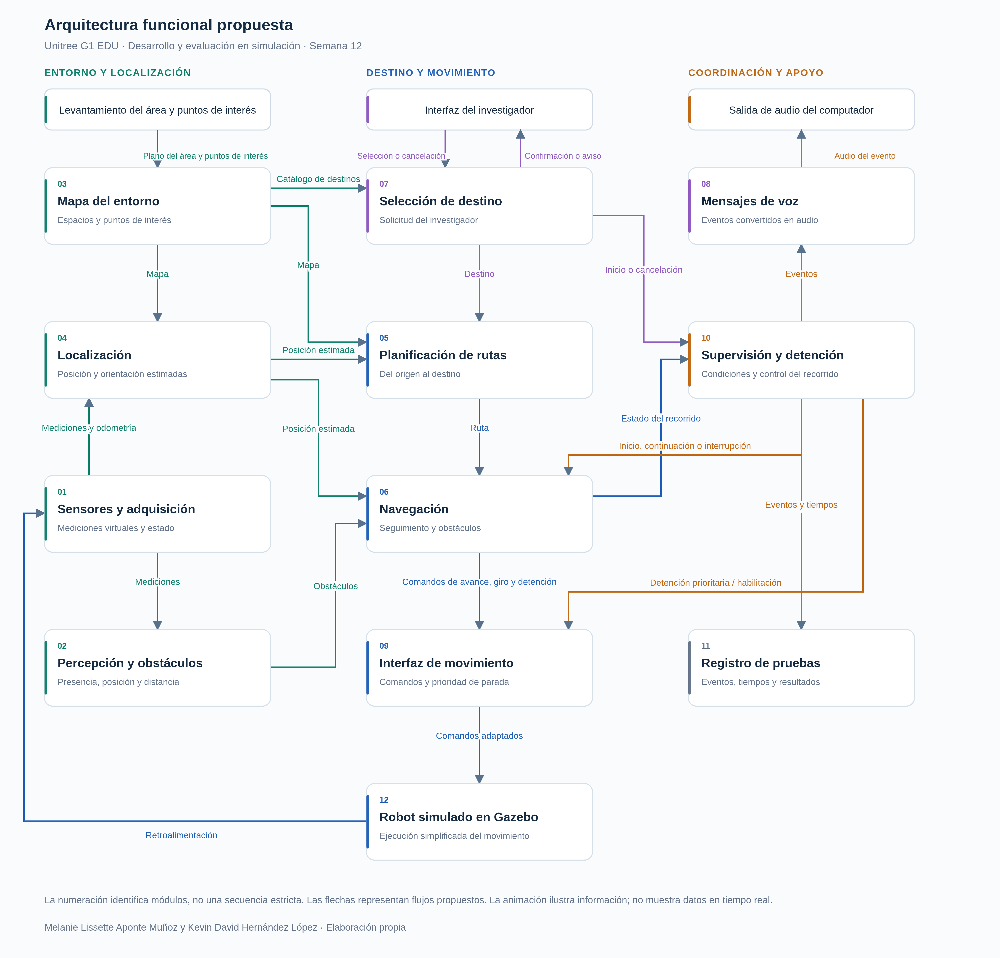

# Proyecto de grado — Navegación asistida con Unitree G1 EDU

Proyecto de investigación sobre una arquitectura funcional de navegación asistida en interiores, orientada a la localización, planificación, percepción de obstáculos, interacción y supervisión del robot humanoide **Unitree G1 EDU** en simulación.

## Esquema de arquitectura funcional

La arquitectura está organizada en módulos y permite examinar sus entradas, salidas y relaciones funcionales. La versión interactiva incluye vistas individuales de los módulos, escenarios de funcionamiento, inventario de flujos y matriz de módulos.

[**Explorar la arquitectura funcional interactiva**](https://melanie0410.github.io/Proyecto-Pregrado-Sistema-de-Navegacion-/)

> **Nota:** el enlace interactivo funcionará una vez habilitado GitHub Pages con la rama `main` y la carpeta `/docs`. El acceso a Pages desde repositorios privados depende del plan y la configuración de GitHub; el sitio publicado puede ser público.

## Archivos del sitio

- `docs/index.html`: página principal de la arquitectura interactiva.
- `docs/matrices.json`: matrices de los módulos.
- `docs/views.json`: información de las vistas por módulo.
- `docs/Conexiones_por_modulo/`: diagramas individuales exportados.
- `docs/Arquitectura_G1.png` y `.svg`: vista general.

## Estado del desarrollo

La página documenta una **arquitectura propuesta y evaluable en simulación**. Las animaciones ilustran flujos funcionales y no son telemetría del robot. La adaptación al hardware real requiere comprobar sensores, interfaces y controladores.
