# Semana 15: modelo G1, pruebas LiDAR y escenario Calatayud

## Alcance y resultados

Se visualizó el modelo oficial del G1 en URDF Visualizer y se convirtió
a SDF para cargarlo fijo en Gazebo Fortress. Se incorporó un LiDAR
virtual aproximado utilizando la referencia mid360_link del fabricante.

Se comprobó la publicación de la nube en Gazebo, su conversión a
sensor_msgs/msg/PointCloud2 mediante ros_gz_bridge y su visualización
en RViz. Se compararon las escenas sin pared y con una pared de prueba.
rqt_graph mostró la conexión del puente con RViz.

## Entorno y dependencia

- Ubuntu 22.04, ROS 2 Humble y Gazebo Fortress.
- Paquetes: ros_gz_bridge, rviz2 y rqt_graph.
- Modelo: g1_29dof_rev_1_0.urdf, provisional hasta confirmar Machine Type.
- Fuente: https://github.com/unitreerobotics/unitree_ros
- Commit: 725b59b6de39a26c425632120c89f23c49a36f1e

Las mallas se consultan desde el repositorio oficial de Unitree;
no están incluidas en esta carpeta. Para preparar la dependencia:

```bash
mkdir -p ~/unitree_referencias
git clone https://github.com/unitreerobotics/unitree_ros.git \
  ~/unitree_referencias/unitree_ros
git -C ~/unitree_referencias/unitree_ros checkout \
  725b59b6de39a26c425632120c89f23c49a36f1e
```

Si el repositorio ya existe, no es necesario clonarlo nuevamente.

## Archivos

- worlds/g1_mundo.sdf: modelo fijo para inspección visual.
- worlds/g1_lidar.sdf: modelo fijo con LiDAR aproximado.
- worlds/g1_lidar_pared.sdf: prueba del sensor con pared.
- worlds/edificio_calatayud.sdf: representación del edificio Calatayud.
- worlds/generar_escenario.py: generador parametrizable del escenario.
- rviz/g1_lidar.rviz: configuración de visualización.
- ../../evidencias/semana_15/: capturas de las pruebas.

## Reproducción

Ejecutar desde la raíz del repositorio del proyecto.

### Terminal 1: Gazebo

```bash
export IGN_GAZEBO_RESOURCE_PATH="$HOME/unitree_referencias/unitree_ros/robots${IGN_GAZEBO_RESOURCE_PATH:+:$IGN_GAZEBO_RESOURCE_PATH}"
ign gazebo simulacion/semana_15/worlds/g1_lidar_pared.sdf
```

Pulsar Play. Para comparar sin pared, cerrar Gazebo y abrir
worlds/g1_lidar.sdf con el mismo procedimiento.

### Terminal 2: puente hacia ROS 2

```bash
source /opt/ros/humble/setup.bash
ros2 run ros_gz_bridge parameter_bridge \
  '/g1/lidar/points@sensor_msgs/msg/PointCloud2[ignition.msgs.PointCloudPacked'
```

### Terminal 3: RViz

```bash
source /opt/ros/humble/setup.bash
rviz2 -d simulacion/semana_15/rviz/g1_lidar.rviz
```

Fixed Frame: g1_29dof_rev_1_0/torso_link/mid360_aproximado
Tópico PointCloud2: /g1/lidar/points
Reliability Policy: Best Effort

### Comprobaciones opcionales

```bash
ign topic -l
```

```bash
source /opt/ros/humble/setup.bash
ros2 topic echo /g1/lidar/points --once --field header
ros2 run rqt_graph rqt_graph
```

## Parámetros y límites

- LiDAR virtual: gpu_lidar, 10 Hz, 640 × 16 muestras.
- Campo horizontal: 360°; vertical: -7° a 52°.
- Intervalo de distancia configurado: 0,1 a 10 m.
- Montaje: pose relativa a mid360_link conservada del modelo oficial.
- Muestreo regular: no reproduce el patrón no repetitivo del MID-360,
  su densidad real ni todos sus errores y características.
- Pared: 0,1 × 4 × 3 m, centro en (2, 0, 1,5) m del mundo.
  Su cara cercana está en X = 1,95 m; no equivale necesariamente
  a la distancia medida desde el sensor.

El robot permanece estático. No se ha implementado locomoción,
odometría ni publicación del árbol TF en ROS 2. La nube se muestra
en su propio marco; puede persistir la advertencia global de TF.
La cuadrícula es visual: estos mundos no incluyen suelo físico.

La comparación con la pared es visual; queda pendiente comprobar
numéricamente las distancias e integrar el escenario medido.


## Evidencias del modelo Unitree G1 y pruebas LiDAR

### Inspección del modelo del robot

Se inspeccionó el modelo oficial `g1_29dof_rev_1_0.urdf` del Unitree G1, identificando su estructura, articulaciones y geometrías de colisión. El archivo URDF original se conserva en el repositorio oficial de Unitree, utilizado como dependencia externa.

**Visualización del modelo URDF**

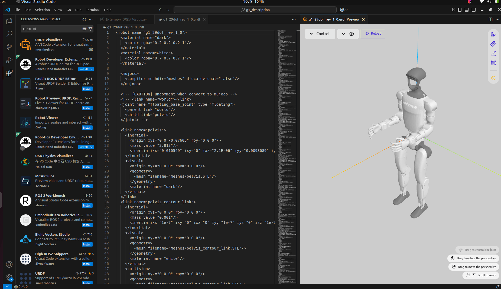

**Geometrías de colisión**

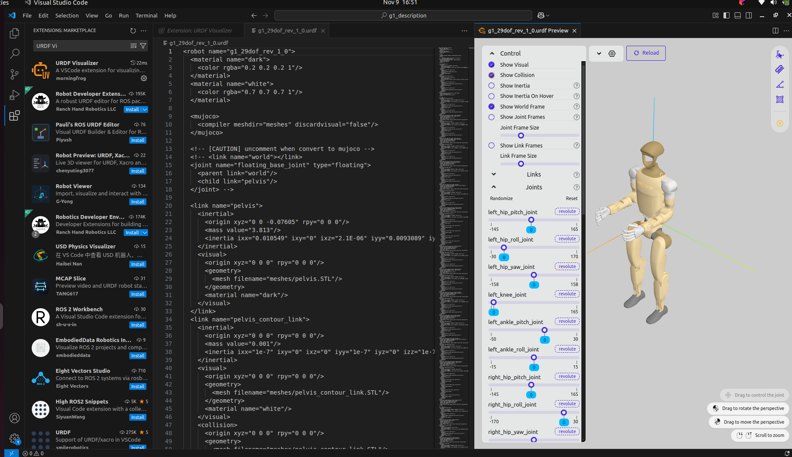

**Articulaciones y sistemas de referencia**

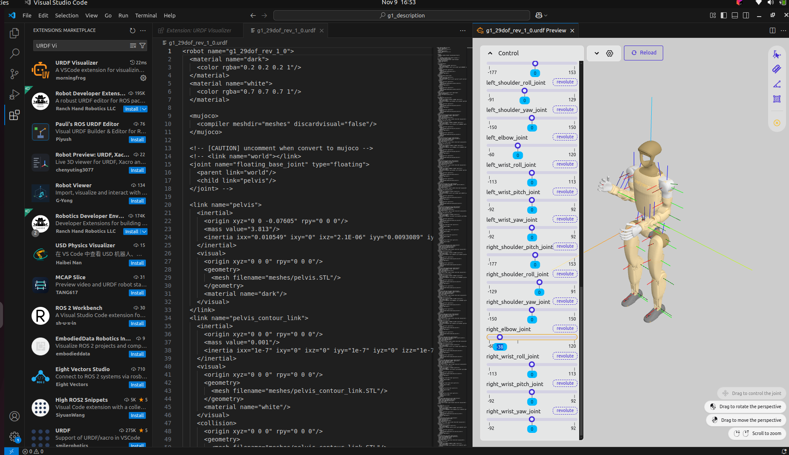

**Representación del G1 en Gazebo Fortress**

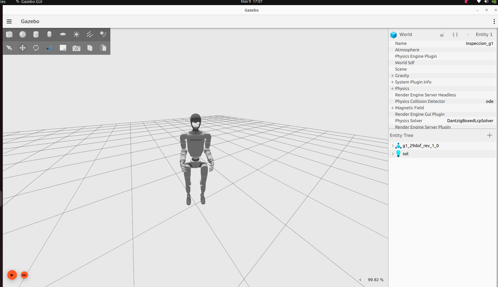

### Pruebas preliminares del LiDAR

Se realizaron pruebas de un LiDAR virtual aproximado, incorporado al modelo del G1, comparando un escenario sin obstáculos con otro que incluye una pared estática.

Los datos generados por Gazebo se transfirieron a ROS 2 mediante `ros_gz_bridge` y se visualizaron en RViz utilizando mensajes `sensor_msgs/msg/PointCloud2`.

**Visualización del LiDAR sin pared**

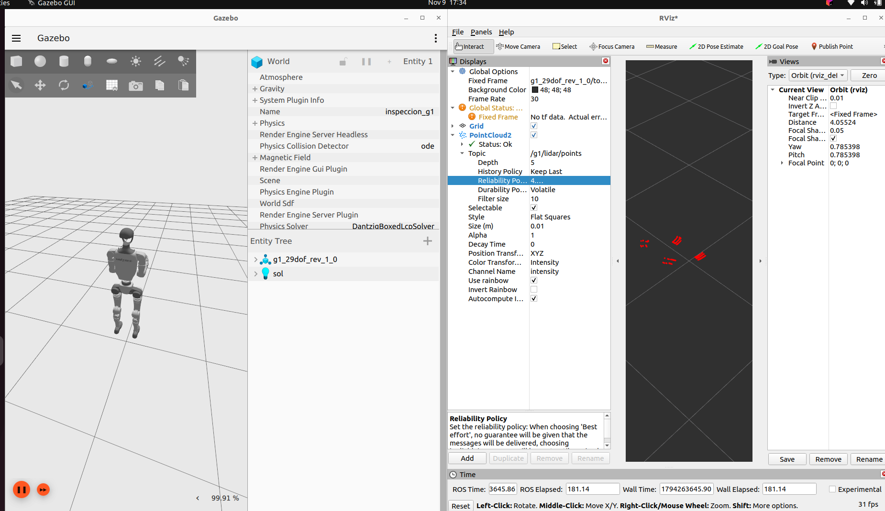

**Prueba con pared y comunicación ROS 2**

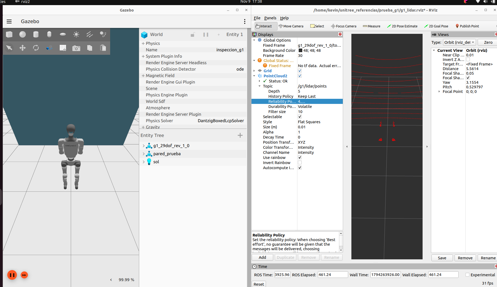

**Visualización ampliada de la nube de puntos con pared**

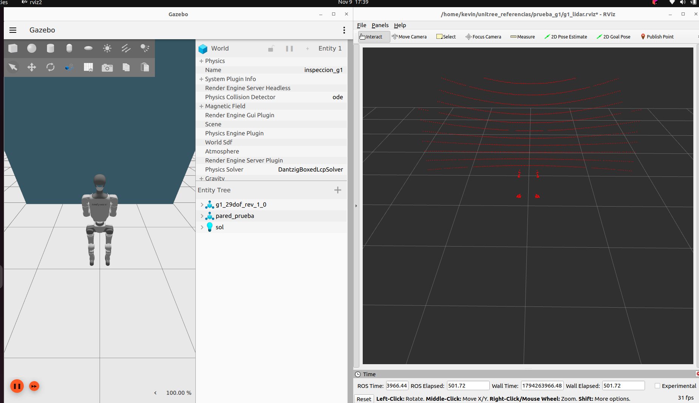

**Comunicación entre nodos mediante rqt_graph**

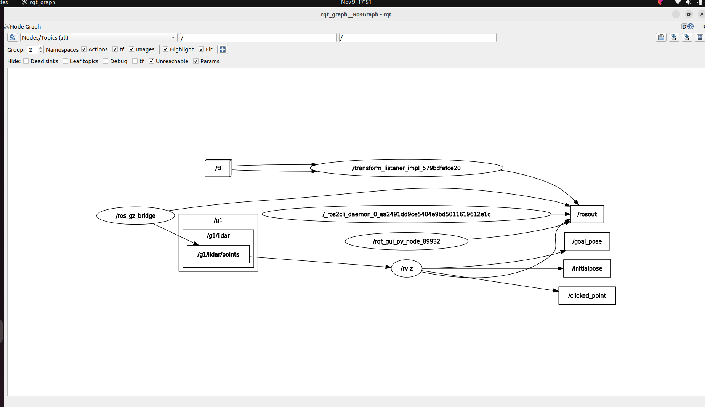


## Escenario del edificio Calatayud

### Construcción del entorno

Se desarrolló una representación tridimensional simplificada del área seleccionada del segundo piso del edificio Calatayud de la Universidad Santo Tomás, utilizando las medidas obtenidas durante el reconocimiento del espacio.

El escenario incorpora corredores, muros, puertas, acceso al ascensor, muretes con barandas y una escalera en U compuesta por dos tramos de bajada y un descanso intermedio.

La geometría se organizó por zonas y se asignaron nombres descriptivos a los elementos, con el propósito de facilitar su identificación, mantenimiento y modificación.

El escenario constituye una base geométrica para las siguientes etapas del proyecto. Su construcción no implica que se haya implementado o validado la navegación autónoma del robot.

### Archivos del escenario

**`worlds/edificio_calatayud.sdf`**

Contiene la representación del entorno en formato SDF (Simulation Description Format). Este archivo permite cargar el escenario directamente en Gazebo Fortress.

**`worlds/generar_escenario.py`**

Script en Python utilizado para generar el archivo SDF a partir de los parámetros geométricos del escenario. Permite modificar dimensiones y posiciones de los elementos definidos en el código y regenerar el modelo sin editar manualmente toda su estructura XML.

### Ejecución en Gazebo Fortress

Desde la raíz del repositorio:

```bash
ign gazebo simulacion/semana_15/worlds/edificio_calatayud.sdf
```

Una vez abierto Gazebo, pulsar **Play** para iniciar la simulación.

Para modificar el escenario se deben ajustar los parámetros correspondientes en `generar_escenario.py` y ejecutar el script desde la carpeta `worlds`, verificando posteriormente el archivo SDF generado.

### Evidencias del escenario

Las siguientes imágenes documentan las principales características de la representación tridimensional:

**Vista general del edificio**

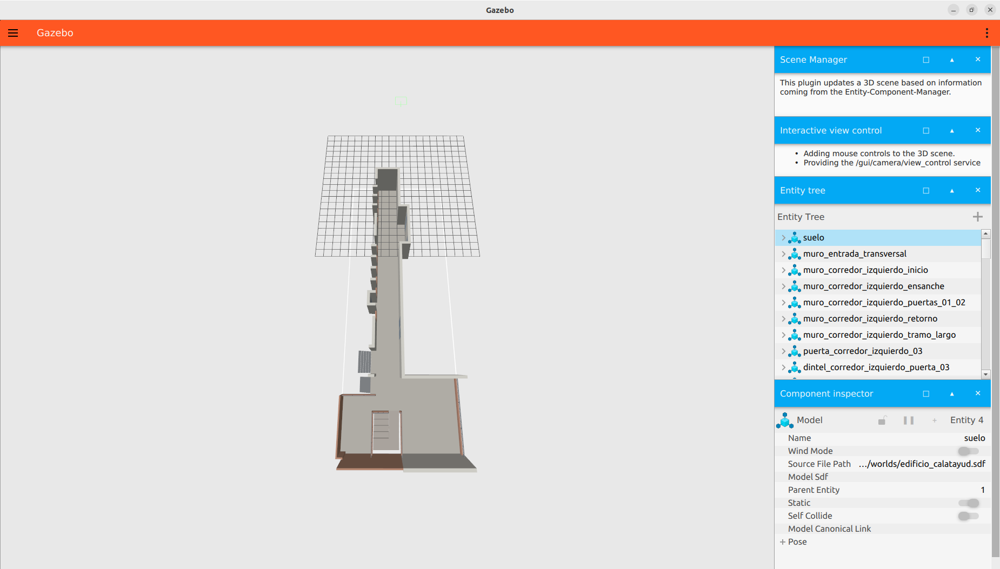

**Escalera en U, descanso y barandas**

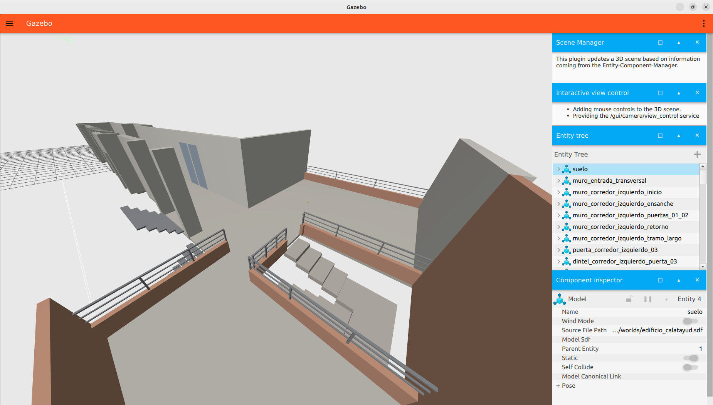

**Corredor y accesos**

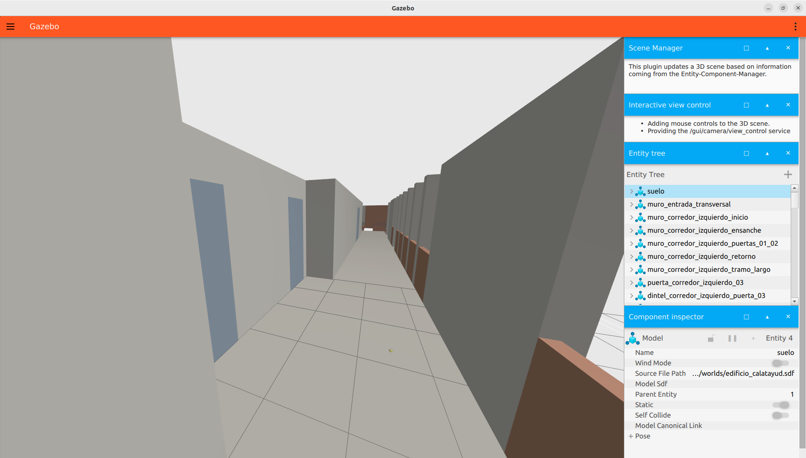

**Zona inferior y acceso**

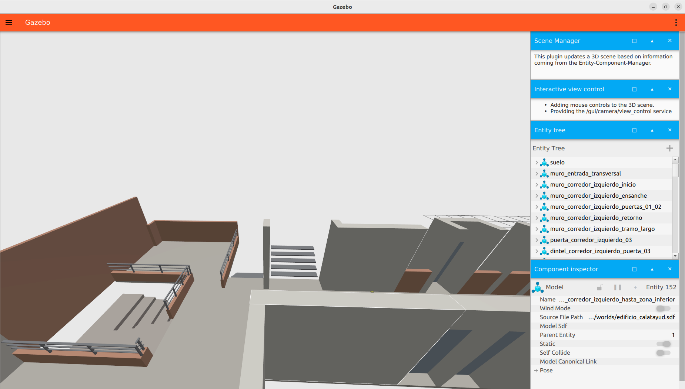

### Resultados y limitaciones

Se comprobó que el archivo `edificio_calatayud.sdf` puede cargarse en Gazebo Fortress y que la geometría construida representa los elementos arquitectónicos seleccionados del edificio.

El generador Python facilita la modificación de la geometría y la regeneración del archivo SDF.

En esta etapa no se ha verificado el desplazamiento del Unitree G1 dentro del escenario Calatayud ni se han ejecutado pruebas de localización, planificación o navegación autónoma sobre este entorno.
