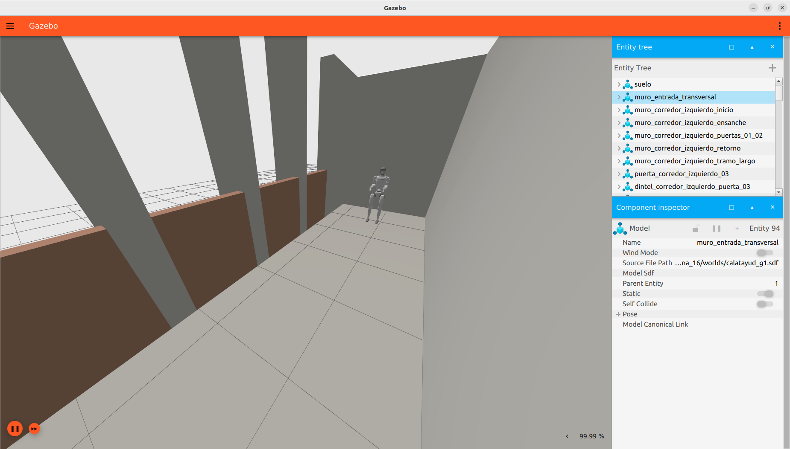
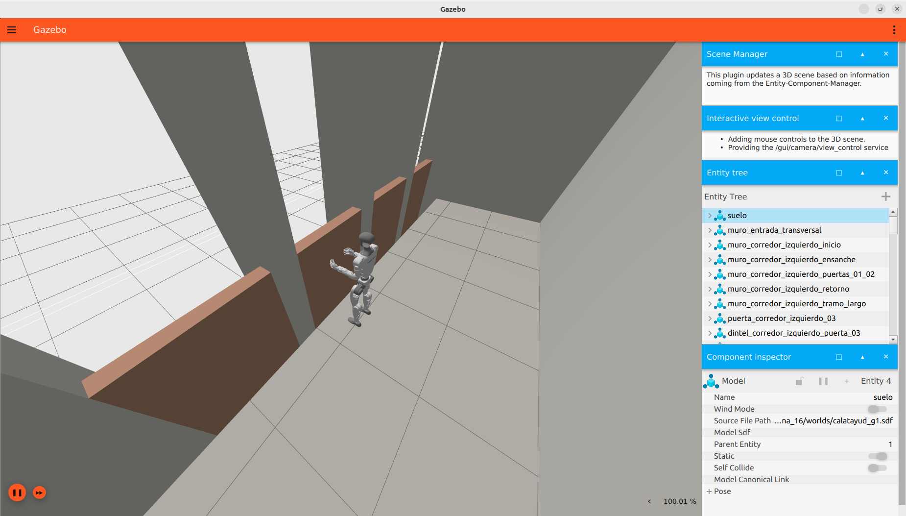
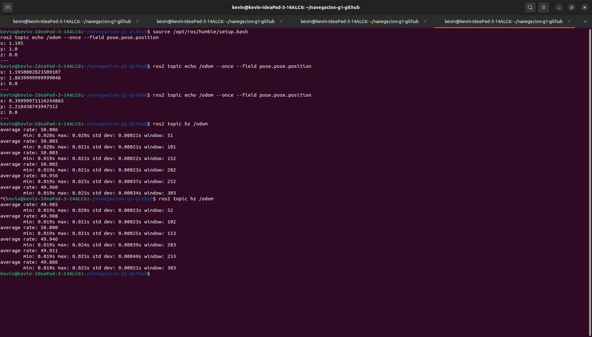

# Semana 16 – Integración del entorno de simulación y modelo Unitree G1

## 1. Descripción general

Durante la semana 16 se trabajó en la integración del modelo del robot humanoide Unitree G1 EDU con el entorno de simulación del bloque Calatayud de la Universidad Santo Tomás.

El trabajo se centró en consolidar un escenario unificado, ajustar la ubicación y las dimensiones del robot dentro del entorno, comprobar su comportamiento físico básico e integrar la publicación de datos de odometría y del sensor LiDAR virtual.

## 2. Objetivos

- Integrar el modelo del robot Unitree G1 EDU con el escenario de simulación del bloque Calatayud.
- Ajustar los parámetros geométricos y la posición inicial del robot.
- Verificar el desplazamiento del robot dentro del entorno.
- Comprobar la publicación de información de odometría.
- Identificar el sistema de referencia asociado a los datos del LiDAR virtual.

## 3. Estructura de archivos

Los archivos desarrollados durante esta semana se encuentran organizados de la siguiente manera:

```text
simulacion/
└── semana_16/
    ├── worlds/
    │   ├── generar_mundo_unificado.py
    │   ├── calcular_altura_pelvis.py
    │   ├── medir_dimensiones_robot.py
    │   └── calatayud_g1.sdf
    └── README.md

evidencias/
└── semana_16/
    ├── Screenshot from 2026-11-19 16-20-09.png
    ├── Screenshot from 2026-11-19 16-29-18.png
    ├── Screenshot from 2026-11-19 16-41-19.png
    ├── 01_robot_corredor.png
    ├── 02_robot_colision_pared.png
    └── 03_prueba_odometria.png
```

## 4. Configuración del escenario

Se desarrolló un mundo unificado que integra la infraestructura del bloque Calatayud con el modelo del robot Unitree G1 EDU.

Para la generación del escenario se utilizaron los siguientes parámetros:

| Parámetro | Valor |
|---|---:|
| Posición vertical inicial (`--z`) | 0.792 m |
| Radio de ajuste (`--radio`) | 0.40 m |
| Altura de ajuste (`--altura`) | 1.32 m |
| Ancho del corredor | 2.39 m |
| Altura entre piso y techo | 3.20 m |
| Espesor de paredes | 0.28 m |
| Altura del murete | 1.23 m |

El archivo SDF generado fue sometido a una comprobación de sintaxis, obteniendo el resultado `Valid.`.

## 5. Pruebas de comportamiento del robot

Se realizaron pruebas de desplazamiento dentro del escenario para comprobar el comportamiento básico del modelo.

Durante la prueba de movimiento hacia adelante, se observó que el robot se desplazó siguiendo su orientación local. En el registro realizado, la coordenada X permaneció en 1.195 m, mientras que la coordenada Y pasó de 1.000 m a 1.864 m.

También se ajustó el radio de colisión a 0.40 m para evitar que las manos del modelo atravesaran las paredes durante la interacción con el entorno.

Estas pruebas permiten verificar aspectos básicos del comportamiento físico del modelo dentro de la simulación, pero no representan una validación de navegación autónoma.

## 6. Verificación de odometría

Se verificó la publicación de información en el tópico `/odom`.

Durante la prueba se obtuvo una frecuencia aproximada de 50 Hz, con un periodo de publicación cercano a 0.020 segundos y una desviación aproximada de 0.0002 segundos.

Estos resultados permiten comprobar la publicación periódica de los datos de odometría en el entorno simulado.

## 7. Integración inicial del sensor LiDAR

Se identificó el tópico `/g1/lidar/points`, correspondiente a la nube de puntos generada por el LiDAR virtual.

Mediante la inspección del encabezado del mensaje se identificó `mid360_link` como el sistema de referencia (`frame_id`) asociado a los datos publicados.

Durante la visualización en RViz se presentó una advertencia relacionada con el filtro de mensajes y el llenado de su cola (`Message Filter ... queue is full`). Por esta razón, todavía se requiere revisar la configuración de los sistemas de referencia TF y completar la visualización de la nube de puntos.

## 8. Estado actual y actividades pendientes

Los avances de esta semana permitieron consolidar el escenario unificado y realizar verificaciones iniciales del modelo del robot.

Quedan pendientes las siguientes actividades:

- Revisar y completar la relación entre los sistemas de referencia TF del robot y el sensor LiDAR.
- Ajustar la configuración de RViz para visualizar correctamente la nube de puntos.
- Evaluar la conversión de PointCloud2 a LaserScan, si resulta adecuada para la arquitectura seleccionada.
- Integrar y evaluar herramientas de SLAM y localización.
- Continuar las pruebas de estabilidad del robot, especialmente en la zona de escaleras.
- Verificar las condiciones de uso y licencia de los recursos del modelo del robot.

## 9. Evidencias de simulación

A continuación, se presentan las capturas correspondientes al escenario desarrollado y a las pruebas realizadas durante la semana 16.

**Figura 1. Evidencia general del entorno de simulación.**


**Figura 2. Evidencia complementaria del escenario.**


**Figura 3. Evidencia complementaria de las pruebas.**


**Figura 4. Modelo Unitree G1 EDU en el corredor.**



**Figura 5. Prueba de colisión con la pared.**



**Figura 6. Prueba de odometría.**



## 10. Conclusión

Durante la semana 16 se avanzó en la integración del robot Unitree G1 EDU con el entorno de simulación del bloque Calatayud. Se consolidó el mundo unificado, se realizaron ajustes geométricos y se verificaron aspectos básicos del desplazamiento y la publicación de odometría.

Adicionalmente, se identificó el sistema de referencia asociado a los datos del LiDAR virtual, dejando como siguiente paso la revisión de TF y la configuración de visualización en RViz. Estos avances constituyen una base para continuar con las etapas de localización, construcción del mapa y navegación dentro del entorno simulado.
